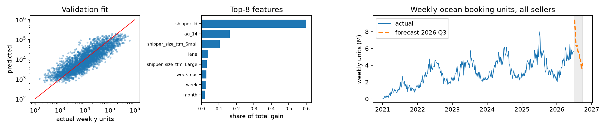

# Ocean booking forecast

Weekly demand forecast for ocean-freight bookings at seller x shipping-lane grain, built during my
Amazon Global Logistics internship (2026). Each quarter the sales team needs, for every seller and
lane, the units that will be booked next quarter.

**Pipeline:** read CSV -> clean -> weekly panel -> calendar + lag features -> LightGBM (Tweedie
objective, custom RMSLE early stopping) -> seasonal-ratio calibration -> plots.



```
best iteration 584; validation RMSLE: LightGBM 0.761 vs naive lag-14 baseline 1.115
seasonal ratio 1.15, calibration coefficient 1.53, 2026 Q3 forecast = 74.0M units
```

## Files

| File | What it is |
|---|---|
| `supplement.py` | The two-page version submitted as a programming supplement: the pipeline that shipped, 130 lines. |
| `ocean_booking_forecast.py` | Full version with every experiment kept (holiday calendar, alternative lags, random-forest comparison, exponential smoothing) and notes on why each was dropped. |
| `make_synthetic_data.py` | Generates an anonymised stand-in for the two input files (same schema, similar shape). No real seller data is in this repository. |

## Run

```bash
pip install -r requirements.txt
python make_synthetic_data.py      # writes data/booking_data.csv and data/Sales_title.csv
python supplement.py               # prints the two lines above, writes supplement_figure.png and forecast_2026Q3.csv
```

Python 3.11+.
